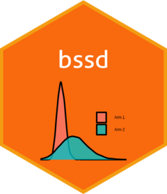

<!-- README.md is generated from README.Rmd. Please edit that file -->
# bssd 

bssd: Bayesian Safety Signal Detection with R

<!-- badges: start -->

<!-- badges: end -->

Sponsors have a responsibility to minimize risk to participants in clinical studies through safety monitoring. The FDA Final Rule for IND Safety Reporting requires routine aggregate safety evaluation, including in ongoing blinded studies. The `bssd` package provides tools to conduct Bayesian Safety Signal Detection (BSSD) analyses in two-arm randomized controlled studies, including both blinded and unblinded studies.

## Introduction

We have the in-progress *ongoing study*. Despite the fact that it may remain blinded, borne of our responsibilities to patients we wish to investigate whether there are any *safety signals*, i.e. evidence to suggest a causative relationship between receiving the active treatment and an increased risk of experiencing adverse events. Consider also that we have a set of *historical studies* whose data we wish to synthesize to derive a prior for the adverse rate(s) in at least one of the arms in the ongoing study.

This encapsulates the two main steps to achieving the BSSD goal:

1.  Meta-analysing data from similar historical studies to derive priors for event rates in unseen studies;
2.  Using those priors in the analysis of the safety data in an ongoing blinded or unblinded study.

A theoretically appealing approach to step 1 is to use Bayesian meta-analysis methods to estimate the meta-analytic predictive (MAP) distributions of the adverse event rates. The predictive distribution is suitable for using in a new study because it reflects the uncertainty arising from study-to-study variability.

The choice of which historical studies to include in step 1 naturally lays with the analyst, but intuitively we seek studies where the planned interventions of the current study have been investigated in the target patient population. This suggests that the methods will most frequently be implemented on the placebo or control arms of historical studies. We do not tend to have an abundance of historical study data for experimental treatments. However, the methods can be applied similarly to active and control arms, if data are available.

Historical data can be observed at:

-   the *patient-level*, where time-at-risk and adverse event status are available for each patient; or
-   the *summary-level*, where intended time-at-risk and aggregate event counts are available for each study.

Generally, we have patient-level data for internal studies, while for external studies, we often only have summary-level data. However, our preference is to obtain patient-level data for external studies whenever feasible. Methods are provided to generate meta-analytic predictive (MAP) distributions from both types of data.

In the context of this documentation, the terms *control* and *placebo* are used interchangeably.

## For additional information

Please see [Article 1 - Specifying priors](https://openpharma.github.io/bssd/articles/article-1-priors.html) for generating priors from historical studies.

Please see [Article 2 - BSSD on a blinded ongoing study](https://openpharma.github.io/bssd/articles/article-2-blinded_bssd.html) for performing BSSD analysis on blinded ongoing studies.

Please see [Article 3 - BSSD on an unblinded ongoing study](https://openpharma.github.io/bssd/articles/article-3-unblinded_bssd.html) for performing BSSD analysis on unblinded ongoing studies.

Please see [Article 4 - Methods](https://openpharma.github.io/bssd/articles/article-4-methods.html) for additional information about the BSSD methodology.

## References

Brock K, Chen C, Ho S, Fuller G, Woolfolk J, McShea C, Penard N. A Bayesian Method for Safety Signal Detection in Ongoing Blinded Randomised Controlled Trials. Pharmaceutical Statistics 2023; 22(2): 378-395. <https://doi.org/10.1002/pst.2278>.

## Acknowledgements

The authors gratefully acknowledge Rosalind J. Walley, Phil Woodward, Arnab Sarkar, Daniel Meddings and Benjamin Duncan for their invaluable support, insights, and contributions to the development of the broader methodological landscape underpinning bssd. The authors also extend their sincere thanks to Cindy McShea for her instrumental support and encouragements throughout the development of the bssd package.
