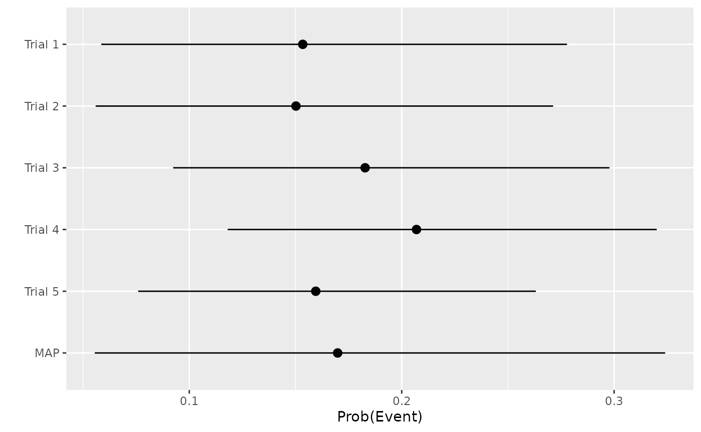
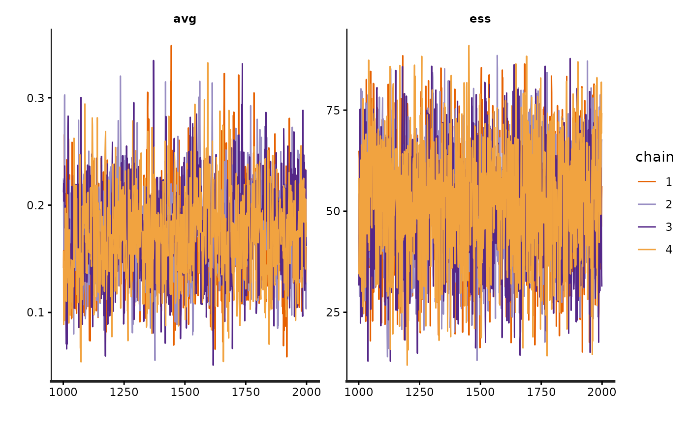
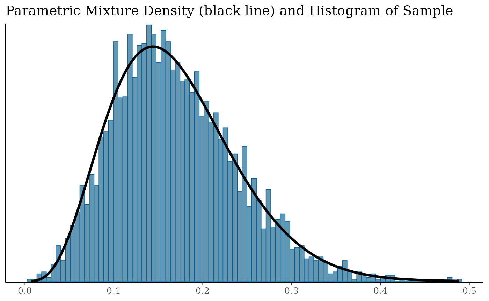

# 1. Specifying priors

``` r

library(bssd)
```

## MAP method for generating a prior from historical studies with patient-level data

Let us create some patient-level historical study data for N=100 placebo
patients collected from 5 studies.

``` r

set.seed(2024)
N <- 100
trial <- sample(1:5, size = N, replace = TRUE)
time <- 0.4 * trial + rexp(N, 20) # Later studies were longer
hazard <- 0.15
prob <- 1 - exp(- hazard * time)
y <- rbinom(N, size = 1, prob = prob)
```

``` r

library(dplyr)

hist_df <- tibble(trial, y, time, prob)
hist_df %>%
  group_by(trial) %>%
  summarise(
    mean_prob = mean(prob),
    events = sum(y),
    n = n(),
    event_rate = mean(y),
    mean_tar = mean(time),
    .groups = "drop"
  )
#> # A tibble: 5 × 6
#>   trial mean_prob events     n event_rate mean_tar
#>   <int>     <dbl>  <int> <int>      <dbl>    <dbl>
#> 1     1    0.0675      1    26     0.0385    0.466
#> 2     2    0.119       1    16     0.0625    0.845
#> 3     3    0.171       5    20     0.25      1.25 
#> 4     4    0.220       9    23     0.391     1.66 
#> 5     5    0.264       4    15     0.267     2.04
```

We see that in this example, all studies are fairly small but later
studies are longer and therefore see more adverse events. Nevertheless,
the hazard in all studies is 0.15 so that the true \pi_j in each study
is:

``` r

1 - exp(-hazard)
#> [1] 0.139292
```

We can attempt to recover these quantities by fitting the above
meta-analytic model using `bssd`:

``` r

x <- stan_map_patient_data(y = y, trial = trial, time = time,
  a_alpha = 1 / 3, a_beta = 1 / 3, b_alpha = 5, b_beta = 5,
  refresh = 0, seed = 2024)
```

The `refresh = 0` parameter suppresses sampling messages from Stan. Note
that the seed setting for R and Stan are independent, so setting seed
for both R and Stan are necessary for reproducible results.

We provided hyperpriors a \sim Beta(1/3, 1/3) and b \sim Beta(5, 5). The
prior on a is uninformative. The prior on b suggests that we expect 50%
borrowing, with associated 95% credible interval (0.21, 0.79).

The returned object contains the Stan model fit:

``` r

print(x$fit)
#> Inference for Stan model: map_prior_patient_data.
#> 4 chains, each with iter=2000; warmup=1000; thin=1; 
#> post-warmup draws per chain=1000, total post-warmup draws=4000.
#> 
#>                 mean se_mean    sd   2.5%    25%    50%    75%  97.5% n_eff
#> a               0.17    0.00  0.04   0.10   0.14   0.17   0.20   0.26  1166
#> b               0.52    0.00  0.14   0.24   0.42   0.52   0.62   0.79  2741
#> pi_h[1]         0.15    0.00  0.06   0.06   0.11   0.15   0.19   0.28  1859
#> pi_h[2]         0.15    0.00  0.06   0.06   0.11   0.14   0.19   0.27  1469
#> pi_h[3]         0.18    0.00  0.05   0.09   0.14   0.18   0.22   0.30  1982
#> pi_h[4]         0.21    0.00  0.05   0.12   0.17   0.20   0.24   0.32  2317
#> pi_h[5]         0.16    0.00  0.05   0.08   0.12   0.16   0.19   0.26  2053
#> pi_star         0.17    0.00  0.07   0.06   0.12   0.16   0.21   0.32  1915
#> pi_star_alpha   8.88    0.08  3.30   3.23   6.55   8.60  10.90  16.06  1631
#> pi_star_beta   43.00    0.23 12.10  19.42  34.42  42.92  51.73  66.05  2786
#> avg             0.17    0.00  0.04   0.10   0.14   0.17   0.20   0.26  1166
#> ess            51.88    0.27 14.34  23.89  41.90  51.96  62.24  78.84  2741
#> lp__          -55.93    0.06  2.24 -61.40 -57.19 -55.53 -54.27 -52.76  1378
#>               Rhat
#> a                1
#> b                1
#> pi_h[1]          1
#> pi_h[2]          1
#> pi_h[3]          1
#> pi_h[4]          1
#> pi_h[5]          1
#> pi_star          1
#> pi_star_alpha    1
#> pi_star_beta     1
#> avg              1
#> ess              1
#> lp__             1
#> 
#> Samples were drawn using NUTS(diag_e) at Fri Oct 16 10:50:19 2026.
#> For each parameter, n_eff is a crude measure of effective sample size,
#> and Rhat is the potential scale reduction factor on split chains (at 
#> convergence, Rhat=1).
```

The \pi_j terms are reflected by the `pi_h` variables in the Stan model.
From the forest plot:

``` r

forest_plot(x)
```



we see that:

- the study-specific means are close to the true value;
- the MAP mean is also close to the true value;
- the MAP distribution is slightly wider than the individual study
  distribution (the additional uncertainty arises from study-to-study
  variability).

Given that the underlying Stan model fit is provided, the usual routines
and methods useful for Stan fits are available to us. For example, to
produce a trace-plot:

``` r

rstan::traceplot(x$fit, pars = c("avg", "ess"))
```



At this point, our beliefs are represented by MCMC samples. To use those
beliefs as a prior in a future analysis, we must represent them using
known analytical distributions. The chances of one particular
distribution adequately representing those samples is slim, so we can
fit a finite mixture distribution:

``` r

mix <- fit_mixture(x)
```

Note that in the [`fit_mixture()`](../reference/fit_mixture.md)
function, the default settings are set to `constrain_gt1 = FALSE` and
`k=2`. This means that the constraints requiring all parameters a & b to
be greater than 1 are turned off, and a value of 2 is used for the AIC
penalty parameter. These defaults are chosen to align with the
corresponding defaults in the SAS function.

We see that the mixture (solid line) fits the samples (histogram) well:

``` r

mix_p <- plot(mix)
mix_p$mix
```



We can inspect the mixture components:

``` r

mix
#> EM for Beta Mixture Model
#> Log-Likelihood = 5115.438
#> 
#> Univariate beta mixture
#> Mixture Components:
#>   comp1    
#> w  1.000000
#> a  4.685179
#> b 22.910056
```

Our prior has mean:

``` r

sum(mix[1, ] * mix[2, ] / (mix[2, ] + mix[3, ]))
#> [1] 0.1697822
```

We can pass a `Nc` parameter to
[`fit_mixture()`](../reference/fit_mixture.md) to define the number of
components in the mixture. For example, to enforce a single beta
distribution, we use:

``` r

fit_mixture(x, Nc = 1)
#> EM for Beta Mixture Model
#> Log-Likelihood = 5115.438
#> 
#> Univariate beta mixture
#> Mixture Components:
#>   comp1    
#> w  1.000000
#> a  4.685179
#> b 22.910056
```

## MAP method for generating a prior from historical studies with summary-level data

The above assumes we had patient-level data for historical studies. This
may not always be the case, e.g. for external studies. We could also
have generated the MAP distribution using summary-level data. In that
situation, the best we can do is to assume the patient-level
time-at-risk is some constant value. Let us assume for the purposes of
illustration, that the time-at-risk can be adequately represented by the
average of the patient-level times in each historical study, we have:

``` r

summ_df <- hist_df %>%
  group_by(trial) %>%
  summarise(
    y = sum(y),
    n = n(),
    time = mean(time),
    .groups = "drop"
  )
```

The model fit to summary-level data uses a different function:

``` r

x2 <- stan_map_summary_data(y = summ_df$y, n = summ_df$n, time = summ_df$time,
  a_alpha = 1 / 3, a_beta = 1 / 3, b_alpha = 5, b_beta = 5, refresh = 0)
forest_plot(x2)
```


This yields similar inferences to those noted above, with final prior:

``` r

mix2 <- fit_mixture(x2)
mix2
#> EM for Beta Mixture Model
#> Log-Likelihood = 5093.131
#> 
#> Univariate beta mixture
#> Mixture Components:
#>   comp1      comp2      comp3     
#> w  0.4114293  0.3617510  0.2268197
#> a 13.1348186  3.0072717 11.4620632
#> b 52.3530471 14.3339988 81.0400338
```

i.e. a Beta mixture with mean:

``` r

sum(mix2[1, ] * mix2[2, ] / (mix2[2, ] + mix2[3, ]))
#> [1] 0.1733592
```

To force a single beta distribution, we run:

``` r

fit_mixture(x2, Nc = 1)
#> EM for Beta Mixture Model
#> Log-Likelihood = 5070.025
#> 
#> Univariate beta mixture
#> Mixture Components:
#>   comp1    
#> w  1.000000
#> a  4.765199
#> b 22.728062
```

## Chi-squared prior from historical studies with summary-level data

The chi-squared method can only use summary level data, i.e. it makes no
use of patient-level follow-up times. Generally speaking, there will be
heterogeneity in times at risk across and between trials. I.e. different
trials treat for differing lengths of time, and patients within trials
sometimes diverge from the protocol. How we go from patient-level data
to summary-level data is a topic for debate, and many of the factors
relating to the general problem of missing data in trials are pertinent.
We demonstrate two possible methods:

1.  a *standardized counts approach*;
2.  a *mean-time approach*.

Naturally other proposals are also available.

### Standardized counts approach

In the *standardized counts approach*, the patient counts are adjusted
to reflect how the realised proportion of intended follow-up differs
from actual follow-up, e.g. a patient that has undergone only 50% of the
intended follow-up contributes 0.5 to the sample size in this approach.

``` r

target_time <- 0.4 * trial + 1 / 20
summ_df <-  tibble(trial, y, time, target_time, prob) %>%
  mutate(t_prop = ifelse(time / target_time > 1, 1, time / target_time)) %>% 
  group_by(trial, time = target_time) %>%
  summarise(
    y = sum(y),
    n = sum(t_prop),
    n_unadj = n(),
    .groups = "drop"
  )

summ_df
#> # A tibble: 5 × 5
#>   trial  time     y     n n_unadj
#>   <int> <dbl> <int> <dbl>   <int>
#> 1     1  0.45     1  25.1      26
#> 2     2  0.85     1  15.6      16
#> 3     3  1.25     5  19.7      20
#> 4     4  1.65     9  22.8      23
#> 5     5  2.05     4  14.8      15
```

Transitioning from patient-level to summary-level data in this way, we
can calculate a prior using the chi-squared method:

``` r

sc_prior <- chi_squ_prior(
  y = summ_df$y,
  n  = summ_df$n,
  time = summ_df$time,
  time_std = 1,
  verbose = TRUE
)

sc_prior
#> $alpha
#> [1] 15.54211
#> 
#> $beta
#> [1] 82.54824
```

The prior has mean:

``` r

with(sc_prior, alpha / (alpha + beta))
#> [1] 0.1584469
```

and effective sample size:

``` r

with(sc_prior, alpha + beta)
#> [1] 98.09035
```

### Mean-time approach

In contrast, under the *mean-time approach*, the patient counts are
unadjusted (i.e. they are taken as observed), but each patient is
assumed to have spent the average time at risk for the trial in which
they took part:

``` r

summ_df <- hist_df %>%
  group_by(trial) %>%
  summarise(
    y = sum(y),
    n = n(),
    time = mean(time),
    .groups = "drop"
  )

summ_df
#> # A tibble: 5 × 4
#>   trial     y     n  time
#>   <int> <int> <int> <dbl>
#> 1     1     1    26 0.466
#> 2     2     1    16 0.845
#> 3     3     5    20 1.25 
#> 4     4     9    23 1.66 
#> 5     5     4    15 2.04
```

This yields a Beta prior:

``` r

mt_prior <- chi_squ_prior(
  y = summ_df$y,
  n  = summ_df$n,
  time = summ_df$time,
  time_std = 1,
  verbose = TRUE
)

mt_prior
#> $alpha
#> [1] 15.45071
#> 
#> $beta
#> [1] 84.54929
```

with mean:

``` r

with(mt_prior, alpha / (alpha + beta))
#> [1] 0.1545071
```

and effective sample size:

``` r

with(mt_prior, alpha + beta)
#> [1] 100
```

The two approaches for summarising historical trials with incomplete
follow-up produce fairly similar priors in this contrived example, but
that is not always the case.
