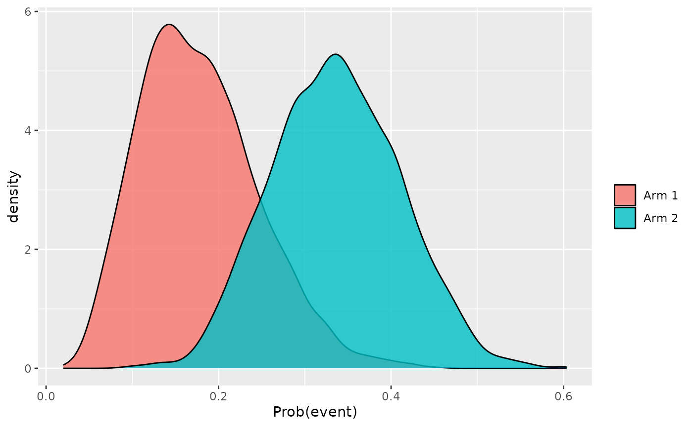
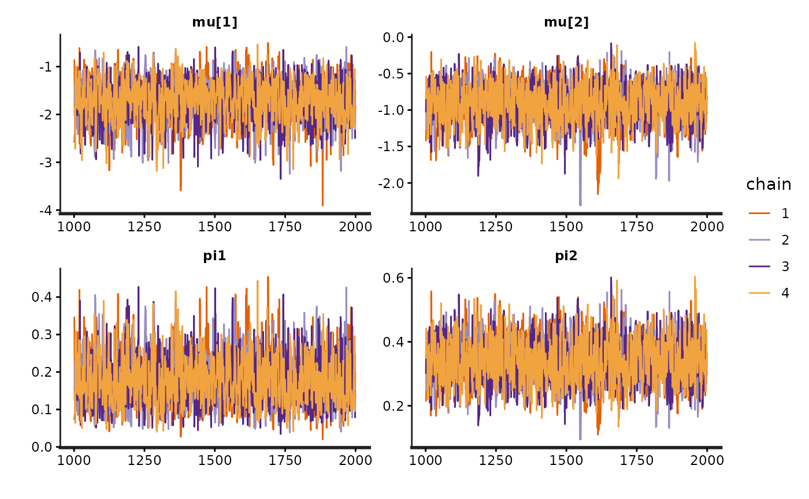

# 2. BSSD on a blinded ongoing study

``` r

library(bssd)
```

## BSSD for a blinded ongoing study

Having specified a prior for the adverse event rate under placebo (see
[Article 1 - Specifying priors](article-1-priors.md)), let us now
concern ourselves with analysing data in an exchangeable
(i.e. scientifically similar) ongoing study.

We will conduct an interim analysis after 100 patients have been
followed-up where these patients are randomized 2:1 (i.e. 1/3 in the
placebo arm (arm 1) and 2/3 in the active arm (arm 2)). To simulate some
outcomes, let’s assume that the hazard of event is 10% under placebo and
20% under active:

``` r

set.seed(2024)
prob_arm1 <- 1 / 3
N <- 100
time <- 0.5 + cumsum(rexp(N, 100))
arm <- sample(1:2, size = N, replace = TRUE, prob = c(prob_arm1, 1 - prob_arm1))
hazard1 <- 0.1
hazard2 <- 0.2
prob <- numeric(length = N)
prob[arm == 1] <- 1 - exp(- hazard1 * time[arm == 1])
prob[arm == 2] <- 1 - exp(- hazard2 * time[arm == 2])
y <- rbinom(N, size = 1, prob = prob)
```

Let’s summarise our interim data:

``` r

library(dplyr)
summary_df <- tibble(arm, y, time, prob) %>%
  group_by(arm) %>%
  summarise(
    mean_prob = mean(prob),
    events = sum(y),
    n = n(),
    event_rate = mean(y),
    mean_tar = mean(time),
    .groups = "drop")
summary_df
#> # A tibble: 2 × 6
#>     arm mean_prob events     n event_rate mean_tar
#>   <int>     <dbl>  <int> <int>      <dbl>    <dbl>
#> 1     1    0.0942      7    31      0.226    0.994
#> 2     2    0.194      22    69      0.319    1.09
```

We will use the following MAP prior derived using patient-level data
from relevant historical studies for the placebo arm. See this link:
[Patient-level MAP prior](./article-1-priors.html#map-prior) for a
refresher on how derive MAP priors using patient-level data.

``` r

w1 <- c(0.556, 0.444)
pi1_alpha <- c(6.673, 4.614)
pi1_beta <- c(27.393, 25.853)
```

We will also use a $`Beta(1/3, 1/3)`$ prior on the active arm,
reflecting our relative ignorance:

``` r

w2 <- 1
pi2_alpha <- 1 / 3
pi2_beta <- 1 / 3
```

#### Blinded ongoing study

To fit the BSSD model for blinded outcomes, we call `stan_bssd` and
specify the `prob_arm1` parameter:

``` r

fit <- stan_bssd(y = y, time = time, prob_arm1 = prob_arm1,
                 w1 = w1, pi1_alpha = pi1_alpha, pi1_beta = pi1_beta,
                 w2 = w2, pi2_alpha = pi2_alpha, pi2_beta = pi2_beta,
                 refresh = 0, seed = 2024)
```

We obtain the estimated mean event rate in each arm, and the posterior
probability that the true event rate is greater in the active arm:

``` r

fit
#> Prob(Event) in arm 1: 0.177 (95% HPDI 0.05, 0.304)
#> Prob(Event) in arm 2: 0.336 (95% HPDI 0.195, 0.475)
#> Prob(Event rate in arm 2 > arm 1): 0.939 (95% HPDI 0.933, 0.945)
```

The model is 0.939 sure that the true event rate is greater under active
arm.

We can obtain summary statistics of the result data:

``` r

summary(fit)
#> # A tibble: 3 × 7
#>   variable     mean median      sd .lower .upper alpha
#>   <chr>       <dbl>  <dbl>   <dbl>  <dbl>  <dbl> <dbl>
#> 1 pi1         0.177  0.170 0.0684  0.0504  0.304  0.05
#> 2 pi2         0.336  0.335 0.0740  0.195   0.475  0.05
#> 3 prob_higher 0.939  0.939 0.00313 0.933   0.944  0.05
```

We can also extract a specific value from the fit
[`summary()`](https://rdrr.io/r/base/summary.html) function, e.g., the
mean for `pi1` from the previous table:

``` r

summary(fit)$mean[summary(fit)$variable == "pi1"]
#> [1] 0.1771715
```

As before, we have default methods for visualising the model inferences:

``` r

plot(fit)
```



and naturally further analysis is possible using the MCMC samples
contained within the `fit` object, along with the various methods
designed for Stan model fits. For instance, a traceplot is easily
obtained:

``` r

rstan::traceplot(fit$fit)
```


